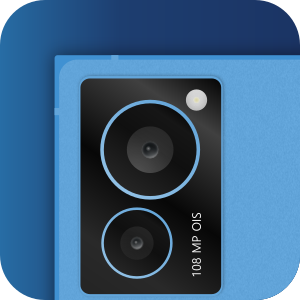

> [!NOTE]
> GitHub users - this project is maintained over [on GitLab](https://gitlab.com/griffin-web-studio/garage/phone-webcam).

[](https://gitlab.com/griffin-web-studio/garage/phone-webcam/-/pipelines)
[](https://gitlab.com/griffin-web-studio/garage/phone-webcam/-/jobs?name=test)

# Phone Webcam (v1.0.1)

The webcam in a laptop is rarely a good one, and the camera in your phone almost
always is. Phone Webcam turns that camera into a virtual webcam that your video
calls, browser and recording tools can pick like any other, with the phone
plugged in over USB.

It is a friendly window around [scrcpy](https://github.com/Genymobile/scrcpy)
that handles the awkward parts for you: finding the phone, setting up the
virtual camera, and keeping the picture steady while you rotate it, switch
lenses or change settings in the middle of a call.

- Use any camera on the phone, front or back, and switch between them while the
  webcam is running without apps losing the camera.
- Rotate and mirror the picture live, in case an app treats mirroring
  differently.
- See exactly what other apps receive in a live preview inside the window.
- Change the resolution, frame rate and bitrate to trade quality against delay.
- Cover the camera with a "Be right back" image with one click, using your own
  SVG if you like.
- A dependency check tells you what is missing and how to install it.

## Requirements

Please note these are **production** requirements, that is to say requirements
for the end user system. For the developer requirements please refer to the
[Dev environment](./CONTRIBUTING.md#dev-environment) section in
[CONTRIBUTING.md](./CONTRIBUTING.md).

- A Linux desktop (X11 or Wayland) with glibc 2.38 or newer, for example Fedora
  39 or later, Debian 13, or Ubuntu 24.04 or later.
- An Android phone with USB debugging turned on, and a USB cable that carries
  data. scrcpy's camera mirroring needs Android 12 or newer.
- [scrcpy](https://github.com/Genymobile/scrcpy) 2.2 or newer, which brings
  `adb` with it.
- `ffmpeg`. For the cover image it should be built with SVG support (librsvg),
  which the usual Fedora and Debian builds are.
- The `v4l2loopback` kernel module, which provides the virtual camera.
- `pkexec` (polkit) and `kmod`, because loading the module needs permission once
  per boot.

No Python is needed, the app is one self-contained file. The RPM and DEB
packages pull in the tools above, except where noted in
[Installation](#installation), and the app checks for everything when it starts
and tells you what is missing.

## Installation

Download the latest package from the
[Releases page](https://gitlab.com/griffin-web-studio/garage/phone-webcam/-/releases/v1.0.1).

### Fedora

```bash
sudo dnf install ./phone-webcam-*.x86_64.rpm
```

scrcpy, adb, ffmpeg and polkit come from Fedora's repositories. The kernel module
comes from [RPM Fusion](https://rpmfusion.org/Configuration), so enable its free
repository if you have not, then install the module:

```bash
sudo dnf install v4l2loopback
```

If your machine uses Secure Boot, the module has to be signed before it will
load. RPM Fusion's documentation explains how to do that.

### Debian and Ubuntu

```bash
sudo apt install ./phone-webcam_*_amd64.deb
sudo apt install v4l2loopback-dkms linux-headers-$(dpkg --print-architecture)
```

Debian does not package a scrcpy new enough for camera mirroring, so install it
from the [official releases](https://github.com/Genymobile/scrcpy/releases) and
put `scrcpy` and `adb` on your `PATH`.

### Nightly builds

Every night that `main` has changed, a build of it is published to the project's
package registry, with the same files as a release. Each one replaces the last, so
there is only ever one nightly, the newest, and its addresses never change:

```bash
curl -fL -o phone-webcam.rpm "https://gitlab.com/api/v4/projects/87418662/packages/generic/phone-webcam/nightly/phone-webcam.rpm"
curl -fL -o phone-webcam.deb "https://gitlab.com/api/v4/projects/87418662/packages/generic/phone-webcam/nightly/phone-webcam.deb"
```

It is an automatic build, not a release, so use it to try what is coming and expect
rough edges. Its version looks like `0.2.0+nightly.57.a1b2c3d`: the release it is
built on, the pipeline and the commit. The binary and `SHA256SUMS` are beside them,
under the same address.

### Just the binary

The package contains one file, which you can also run on its own. Nothing is
installed or changed on your system:

```bash
chmod +x phone-webcam
./phone-webcam
```

The first start unpacks the app into `~/.cache/Griffin Web Studio/Phone Webcam/`,
and later starts reuse that, so they are quicker.

## First run

Open **Phone Webcam** from your app menu, or run `phone-webcam`.

1. **Dependency check.** A short checklist runs. When everything passes you go
   straight to the main window. Otherwise it shows what is missing with one
   install command and a **Copy** button. Run it, then press **Re-check**.
2. **Phone notice.** Until a phone is ready, the window is covered by a notice
   that says what to do: plug it in, turn on USB debugging, or tap **Allow** on
   the phone when it asks. It goes away by itself as soon as the phone is ready.
3. **Main window.** The side panel on the left has the controls, and the main
   area shows the preview and the log.

Press **Start**. The first time after each boot, a password prompt appears so the
virtual camera can be created. After a moment the status reads **Running**, and
a camera called **Android Webcam** is available to other apps.

## Using it

| To do this                         | Do this                                                 |
| ---------------------------------- | ------------------------------------------------------- |
| Start or stop the webcam           | The first button under the status.                      |
| Pick another lens                  | **Camera**, then choose it. The ↻ button looks again.   |
| Turn the picture                   | **Orientation**, then the rotate buttons. **Reset** undoes it. |
| Mirror the picture                 | **Orientation**, then **Mirror**.                       |
| Hide the picture for a moment      | **Cover camera**. Press again to uncover.               |
| Trade quality against delay        | **Stream settings**.                                    |
| Copy the log to report a problem   | **Copy**, above the log.                                |

The side panel can be dragged wider or narrower, and its width is remembered.
There is a fuller walkthrough in the [user guide](docs/user-guide.md).

## Settings

Everything is changed in the window, and your choices are saved. Nothing needs
editing by hand.

### Stream settings

| Setting      | Choices                    | Default  | Notes                                                 |
| ------------ | -------------------------- | -------- | ----------------------------------------------------- |
| Resolution   | 1080p, 720p                | 1080p    | Only while stopped, apps agree on it when they open the camera. |
| Frame rate   | 15, 24, 30, 60             | 30       | Changes live, with a short pause while the phone restarts its camera. |
| Bitrate      | 4, 8, 12, 16, 24 Mbit/s    | 8        | Changes live, like the frame rate.                    |
| Preview rate | 15, 30, 60                 | 30       | Never faster than the frame rate. Changes any time.   |

A camera that cannot do what you ask is held to the closest thing it can do, and
if it refuses outright, the app goes back to the previous choice and says so in
the log. Lower resolution, frame rate and bitrate all mean less delay.

### Cover image

| Setting                          | Default                  | Notes                                       |
| -------------------------------- | ------------------------ | ------------------------------------------- |
| Title                            | Be right back            | Up to 32 characters.                        |
| Subtitle                         | Camera is covered        | Up to 64 characters.                        |
| Image                            | Built in                 | Any SVG, see [cover images](docs/cover-images.md). |
| Show a notice while busy         | On                       | "One moment" while the camera starts or switches. |
| Mirror the cover with the picture | On                      | The cover is never rotated.                 |

The cover hides the picture from other apps, but the phone's camera keeps
running behind it, so the phone's camera indicator stays on. Stop the webcam if
you want the camera itself off.

### The settings file

`settings.ini` only holds the name shown in the window. Your choices are in
`~/.config/phone-webcam/prefs.json`. If something ever gets into a state you do
not like, delete that file and the app starts fresh.

## How it works

1. **Checks.** The app checks that a window can be opened, then that the phone
   and webcam tools are installed.
2. **Devices.** It looks for a virtual camera called `Android Webcam`, and
   creates it if it is missing, asking for permission once.
3. **Pipeline.** scrcpy records the phone's camera into a private pipe. ffmpeg
   decodes it, the app turns it as asked, and a second ffmpeg writes it to the
   virtual camera at a steady rate. That second one never closes while the app
   runs, which is why rotating, switching lenses and changing settings never make
   an app lose the camera.
4. **Preview.** The preview is made from the same frames, so it shows what other
   apps receive.

The [architecture](docs/architecture.md) document goes into the detail.

## Command line

| Option                    | Does                                                           |
| ------------------------- | -------------------------------------------------------------- |
| (none)                    | Open the window.                                               |
| `--check`                 | Run every dependency check, print the result and exit.         |
| `--simulate-missing KEYS` | Pretend the named checks fail, to see how a missing tool looks. |
| `-h`, `--help`            | Show the usage.                                                |

The exit code is `0` for success, `1` if `--check` found a required dependency
missing, `2` if no window can be opened, and `3` if the window failed to start.
`man phone-webcam` has the same.

## File locations

| Path                                                                  | Purpose                              |
| --------------------------------------------------------------------- | ------------------------------------ |
| `/usr/bin/phone-webcam`                                               | The app (packages)                   |
| `~/.config/phone-webcam/prefs.json`                                   | Your saved choices                   |
| `~/.cache/Griffin Web Studio/Phone Webcam/<version>/`                 | The unpacked app, made on first start |
| `/usr/share/applications/studio.griffin_web.phone_webcam.desktop` | App menu entry                       |
| `/usr/share/icons/hicolor/scalable/apps/studio.griffin_web.phone_webcam.svg` | App icon                  |
| `/usr/share/metainfo/studio.griffin_web.phone_webcam.metainfo.xml` | Software centre details             |
| `/usr/share/man/man1/phone-webcam.1.gz`                               | Manual page                          |

## Uninstalling

```bash
sudo dnf remove phone-webcam     # Fedora
sudo apt remove phone-webcam     # Debian and Ubuntu
```

Your saved choices and the unpacked app are left in place. Delete
`~/.config/phone-webcam/` and `~/.cache/Griffin Web Studio/` if you want them
gone. The virtual camera stays until you restart, or run
`sudo modprobe -r v4l2loopback` once nothing is using it.

## Troubleshooting

The [troubleshooting guide](docs/troubleshooting.md) covers the usual problems:
a phone that is not found, a virtual camera that will not load, a black picture,
a camera that reports busy, and delay.

## Development

See [CONTRIBUTING.md](CONTRIBUTING.md) for the dev setup, commit conventions,
test suite, and release process. The rest of the documentation is in
[docs/](docs/README.md).
