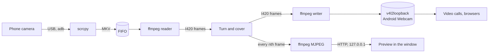
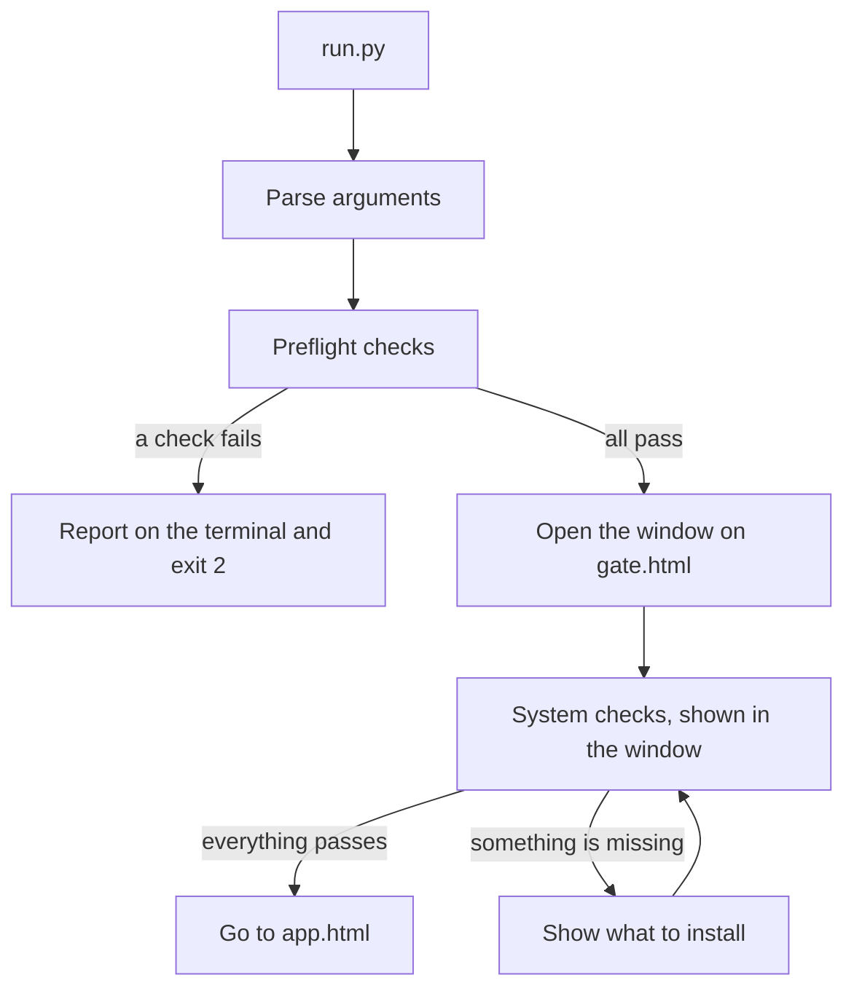
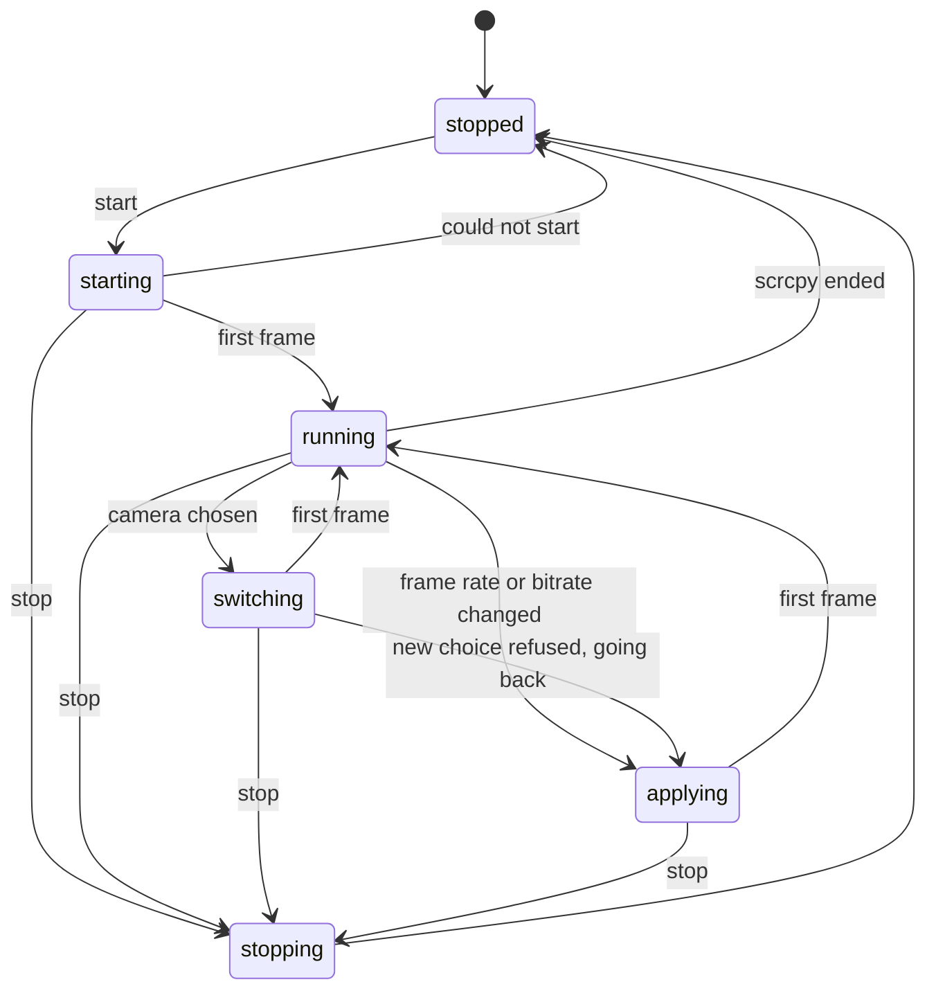

# Architecture

How Phone Webcam turns a phone's camera into a webcam, and how the code is
organised. Read this before changing anything that touches the video path, the
threads or the Python to page bridge.

## The idea

The phone is the camera. scrcpy reads it over USB, and a small pipeline turns
the picture as asked and writes it into a v4l2loopback device, which looks like
an ordinary webcam to every other app. The window is a web page shown by
pywebview, and Python does all the real work.

Three choices in that picture are deliberate, and the reasons are in
[Design notes](#design-notes).

- The output device never closes while the app runs, so apps never see the
  camera vanish when you rotate, switch cameras or change settings.
- Turning, mirroring and the cover happen in Python, on each frame, so they
  change instantly and never restart anything.
- The preview is made from the frames the pipeline has already produced, so it
  shows exactly what other apps receive and never opens a loopback device.

## Modules

Everything is in `phone_webcam/`. Modules marked *stdlib* import nothing
outside the standard library, which lets the dependency checks run before the
GUI libraries are loaded.

| Module        | What it does                                                       |
| ------------- | ------------------------------------------------------------------ |
| `main.py`     | Start-up: command line, preflight checks, opens the window. *stdlib until the window opens* |
| `deps.py`     | Dependency checks, distribution detection, install commands. *stdlib* |
| `api.py`      | The bridge the page calls, and the ordered event queue back to it. |
| `webcam.py`   | The controller: run lifecycle, state machine, cameras, cover, preview. |
| `pipeline.py` | Reads frames, turns them, writes them out at a steady rate.        |
| `preview.py`  | Encodes frames to MJPEG and serves them on a local port.           |
| `slate.py`    | Draws the cover image from an SVG with ffmpeg. *stdlib*            |
| `loopback.py` | Finds and creates the v4l2loopback device. *stdlib*                |
| `phone.py`    | Watches adb for the phone and reports its state. *stdlib*          |
| `cameras.py`  | Lists the phone's cameras, picks a size and frame rate. *stdlib*   |
| `settings.py` | Validated stream and cover settings. *stdlib*                      |
| `config.py`   | `settings.ini` and the saved preferences. *stdlib*                 |
| `clipboard.py`| Copies text through Qt, from any thread.                           |
| `web/`        | The interface: plain HTML, CSS and JavaScript with JSDoc types.    |

## Starting up

There are two tiers of checks, and the split matters.

- **Preflight** asks whether a window can be opened at all: a graphical
  session, the system libraries Qt WebEngine needs, and the Python packages. If
  one fails there is no window to show it in, so it is reported on the terminal
  (and in a desktop pop-up when launched without one) and the app exits with
  code 2.
- **System checks** ask whether the phone and webcam tools are installed:
  scrcpy, adb, ffmpeg, pkexec, modprobe and the kernel module, plus optional
  ones. They run inside the window, because by then the GUI works and can
  explain what is missing. The screen goes straight to the main view when all
  of them pass.

`run.py` imports nothing but `phone_webcam.main`, and `main.py` only imports the
GUI libraries once preflight has passed. Keep it that way, or the checks can no
longer report a broken GUI stack.

## A run, step by step

`Webcam.start()` moves to `starting` and runs everything slow on one worker
thread, so the window never blocks.

1. **Phone.** `adb devices` must show a ready phone.
2. **Loopback device.** Look for a device labelled `Android Webcam` in
   `/sys/class/video4linux`. If it is missing and the module is not loaded, load
   it with one `pkexec` prompt. If the module is loaded without that label,
   add the device with `v4l2loopback-ctl`, or after a confirmation reload the
   module. It refuses if another app is using the module.
3. **Pipeline.** Make a private FIFO, draw the cover images, start the writer
   ffmpeg (which opens the output device straight away), then the reader ffmpeg.
   The reader's open of the FIFO waits for scrcpy.
4. **scrcpy.** Start it on a pseudo-terminal, recording MKV into the FIFO.
5. **First frame.** When the reader delivers its first decoded frame the state
   becomes `running`. Until then the output shows the "starting" notice.

Ending is the reverse. A stop terminates scrcpy, the reader sees the FIFO close
and everything is cleaned up on the same worker thread.

### States

`switching` and `applying` are the same mechanism with different labels. The
controller ends scrcpy, the run loop sees why, restarts the reader on the same
FIFO and starts scrcpy again, while the writer keeps repeating the last frame.
If scrcpy refuses the new camera or settings before any frame arrives, the
controller restores the previous choice and says so in the log.

## The video path

### Frames

Frames stay in planar YUV 4:2:0 (I420) end to end. It is what the decoder
produces and what the output wants, and at half the size of RGB it keeps the
pipes light. At 1080p that is 3.1 MB per frame.

### Reader

One ffmpeg decodes the FIFO to raw frames. A thread reads exactly one frame at a
time into a fresh buffer and publishes it as the latest frame, so the writer
never waits for it and a slow reader never queues frames up. The picture is
scaled and padded to the output size, which letterboxes cameras that are not
16:9.

### Turn and cover

The writer thread runs at the output frame rate. Each tick it takes the latest
frame, or the cover frame if one is set, and applies the orientation with numpy.
Planes are views, so with no rotation or mirror nothing is copied. A rotation to
portrait is scaled to fit and centred on a padded canvas.

- Rotation puts the camera the right way up and applies only to the camera.
- Mirror applies to the camera, and to the cover if the cover option allows it.
- A cover replaces the repeated frame, and the reader keeps reading behind it,
  so uncovering shows the live picture at once.

### Writer

A second ffmpeg reads raw frames on its standard input and writes them to the
loopback device. It is started once and never restarted during a run. When the
phone stalls, the writer simply keeps repeating the last frame, so apps see a
still picture, not a dead camera.

### Preview

When the window is in front and the webcam is running, a small ffmpeg shrinks
every nth turned frame to 480 pixels wide and encodes it as MJPEG. A threaded
HTTP server on `127.0.0.1`, on a random port with a random token in the path,
streams it as `multipart/x-mixed-replace`, which an `` shows natively.

The preview is dropped when the window loses focus. The controller keeps what is
wanted and what exists in line from one worker, so a focus change during a start
or stop is never lost.

## Threads

| Thread                 | Owns                                                        |
| ---------------------- | ----------------------------------------------------------- |
| Qt main thread         | The window and the web engine. pywebview runs it.           |
| pywebview API threads  | Each call from the page into `Api`.                         |
| Event pump             | The only thread that calls `evaluate_js`, so events arrive in order. |
| Webcam worker          | One run: devices, scrcpy, reading its output.               |
| Phone monitor          | Polls adb every two seconds.                                |
| Reader loop, drain     | Frames in, and the reader's error output out of the way.    |
| Writer loop            | Frames out, at a steady rate.                               |
| Preview feed, collect, server | Encoding and serving the preview.                    |
| Reconcile worker       | Starts or stops the preview to match what is wanted.        |

Rules that keep this safe:

- Nothing slow runs on an API thread or while holding the controller's lock.
  Anything that has to wait for ffmpeg, pkexec or adb goes on a worker.
- Python reaches the page only through the event queue, and the page reaches
  Python only through `window.pywebview.api`.
- Qt objects are touched on the Qt thread. The clipboard does this with a signal
  that is queued to the thread the object was created on.

## The bridge

The page calls methods on `Api` and gets a promise back. Python pushes events,
each a small dictionary with a `type`, through one queue and one sender thread,
which calls `window.onWebcamEvent(...)`. The shapes are written down in
`web/types.d.ts` and checked by hand, because type checking cannot cross the
boundary. When you add an event or a method, change `api.py`, `app.js` and
`types.d.ts` together.

| Event         | Meaning                                                      |
| ------------- | ------------------------------------------------------------ |
| `state`       | The run state changed.                                       |
| `log`         | One line for the log pane.                                   |
| `phone`       | The phone's state changed, drives the connection notice.     |
| `camera`      | The chosen camera changed.                                   |
| `orientation` | Rotation or mirror changed.                                  |
| `settings`    | Stream settings changed.                                     |
| `cover`       | Cover text, image or options changed.                        |
| `shutter`     | The cover was switched on or off.                            |
| `preview`     | The preview is starting, open, stopping or closed.           |
| `confirm`     | A yes or no question for the user, answered with `answer`.   |

## Settings and saved choices

- `settings.ini` holds branding only, the name shown in the window.
- Everything the user changes is saved in
  `~/.config/phone-webcam/prefs.json` (or under `$XDG_CONFIG_HOME`): rotation,
  mirror, stream settings, cover settings and the side panel width.
- The camera choice and the shutter are deliberately not saved. A cover that
  appears by itself at the start of a call would be worse than none.
- `settings.py` validates every value and falls back to the default one field at
  a time, so a hand-edited or old file can never stop the app starting.
- pywebview runs in private mode, which means the page's own storage does not
  survive a restart. That is why preferences go through Python.

## Dependencies on the system

`deps.py` is the single table of system packages, per distribution family. The
app's checks, the install command it suggests and the packages' dependency lists
(`scripts/gen_requires.py`) are all made from it, so they cannot disagree.
Optional tools, and the kernel module, are only recommended by the packages.

## Design notes

Why things are the way they are, for anyone tempted to change them.

**One loopback device, fed through a FIFO.** An earlier version used a second,
hidden loopback device between scrcpy and the pipeline. Browsers listed it as a
black camera, and it made setup harder, because the module needed two devices.
Recording from scrcpy into a FIFO needs only the output device.

**Keyframes every second.** Fedora's ffmpeg decodes H.264 with libopenh264,
which needs the stream's parameter sets in the data. Without frequent keyframes
the first picture took about twenty seconds. scrcpy is told
`i-frame-interval=1,prepend-sps-pps-to-idr-frames=1`.

**scrcpy runs on a pseudo-terminal.** scrcpy buffers its own messages when
writing to a pipe, so they arrived only when it exited. On a terminal it prints
line by line. The terminal escape codes it then emits are stripped.

**No stripping, ever, of the built binary.** The Nuitka launcher has the whole
app appended to it. Stripping the ELF file cuts that off.

**Copying goes through Qt.** pywebview's Qt backend throws when the page uses
the asynchronous clipboard API, and the web engine's own copy did nothing on
some Wayland setups, so the page asks Python to copy.

**Text selection is switched back on only where it matters.** pywebview turns
selection off for the whole page. The log and the command box turn it on again.

**The preview stops when the window is in the background.** The encoding is
wasted work when nobody can see it, and restarting it takes a fraction of a
second.

**Exclusive caps.** The device is created with `exclusive_caps=1`, which
browsers need to treat it as a capture device. A consequence is that it only
shows as a capture device once something has written a frame, which the writer
does immediately, so the device is never empty when apps look.

## Known limits

- The cover and the notices can only show while the output device is open. While
  the module is being reloaded there is no device, so nothing can be shown.
- Changing the resolution changes the output device's format, so it is locked
  while running. Frame rate and bitrate change live by restarting scrcpy.
- PyQt6 under Nuitka has a documented caveat about Qt threading. The compiled
  binary has been run with the clipboard bridge and the pywebview calls, which
  both cross threads, without trouble. If it ever misbehaves, PySide6 is
  Nuitka's recommended binding.
