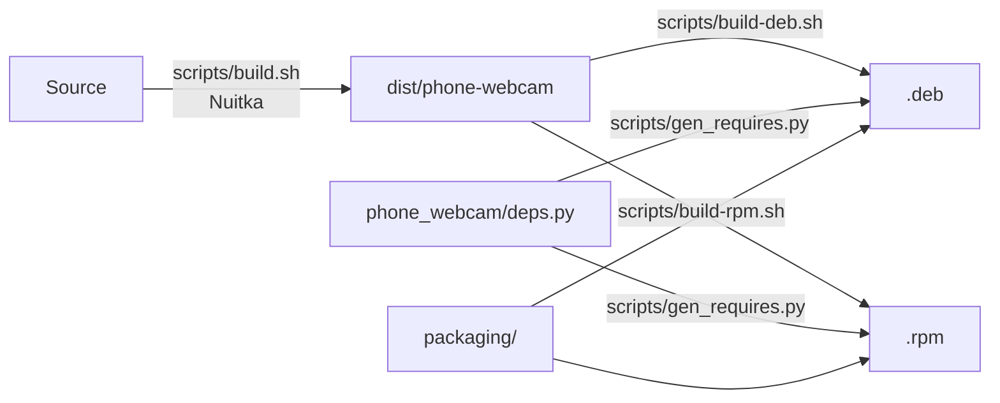

# Building and packaging

How the app becomes a single binary, and how that becomes an RPM and a DEB. For
the commands alone, see
[Building locally](../CONTRIBUTING.md#building-locally) in the contributing guide.



Nothing is compiled when a package is made. The packages carry the finished
binary, so the binary, the DEB and the RPM always contain exactly the same app.

## What you need

Everything is in the devcontainer. On another machine:

| Tool                                              | For                                 |
| ------------------------------------------------- | ----------------------------------- |
| `uv`, Python 3.14                                 | Building, and the version lookups.  |
| `gcc`, `patchelf`                                 | Nuitka compiles C, and rewrites library paths. |
| `ccache` (optional)                               | A much quicker second build.        |
| `dpkg-dev` (`dpkg-deb`, `dpkg-shlibdeps`)         | The DEB.                            |
| `rpm-build` (`rpmbuild`)                          | The RPM.                            |
| `lintian`, `rpmlint`, `desktop-file-utils`, `appstream` | Checking the results.         |

Nuitka and its compression library are in the `build` extra, which
`uv sync --all-extras` installs.

## The binary

`scripts/build.sh` runs Nuitka in `--mode=onefile`, which makes one self-extracting
file in `build/` and copies it to `dist/phone-webcam`. The version comes from
`pyproject.toml`.

The desktop entry, icon and metadata are not made by Nuitka. Its `app` mode can
write them, but it invents an id from the company name, and the id has to be the
real reverse domain, so the ones in `packaging/` are used instead. See
[The application id](#the-application-id).

### How a start works

The binary is a small launcher with the whole app, compressed, appended to it. On
the first start it unpacks into
`~/.cache/Griffin Web Studio/Phone Webcam/<version>/` (about 465 MB), and every
later start runs from there, which is why only the first one is slow. The folder
name comes from `--onefile-tempdir-spec`, using the company, the product and the
version.

### Choices in the Nuitka command

| Flag                                         | Why                                              |
| -------------------------------------------- | ------------------------------------------------ |
| `--enable-plugin=pyqt6`                      | Brings Qt and the web engine, with their resources. |
| `--include-module=webview.platforms.qt`      | pywebview chooses its backend by name at run time, so Nuitka cannot see it. |
| `--include-module=qtpy`                      | Only what is imported, not every Qt module qtpy knows about. Together with the translations flag, this took the unpacked size from 636 MB to 465 MB. |
| `--noinclude-qt-translations`                | The app has no translations to show.             |
| `--include-data-dir` for `web`, `slates`, `assets` | The interface, the default cover and the icon the cover shows. |
| `--include-data-files` for `settings.ini`    | The branding name.                               |
| `--onefile-tempdir-spec`                     | A fixed cache folder, so starts are quick.       |

pywebview's own scripts are found by Nuitka itself, so they need no flag.

### Things that will catch you out

**A rebuild with the same version runs the old files.** The unpack folder is named
after the version, and a start only unpacks when the folder is not there. When
testing, delete
`~/.cache/Griffin Web Studio/Phone Webcam/<version>` after each build, or run the
binary with `XDG_CACHE_HOME` pointing at an empty folder. A release gets a new
version, so it never matters for users.

**Never strip the binary.** The launcher is an ordinary ELF file with the app
appended after it, and `strip` rewrites the file and drops that. The packaging
scripts leave the file alone, and the RPM spec switches off rpm's post-install
steps for the same reason. If a tool offers to strip, compress or "fix" the
binary, say no.

**Data has to be listed.** The compiled app only has the files Nuitka was told
about. A new folder the app reads at run time needs an `--include-data-dir` line
in `scripts/build.sh`, or it works from source and fails in the binary.

**Qt threading.** Nuitka's PyQt6 plugin warns that PyQt6 support is "not perfect,
e.g. Qt threading does not work", and recommends PySide6. The app crosses threads in
two places, the clipboard bridge and pywebview's calls, and both work in the
compiled binary on a real desktop. If a thread problem ever appears only in the
binary, switching to PySide6 is the first thing to try.

**Qt library checks in the binary.** The dependency check finds Qt differently in
a compiled build, because the import system has no spec for it. `deps._qt_root`
looks beside the compiled modules when the normal lookup fails.

### Compatibility: glibc

The binary needs a glibc at least as new as the newest symbol anything inside it
uses. Built in the Debian 13 devcontainer that is **2.38**, which covers Fedora 39
and later, Debian 13 and Ubuntu 24.04 and later. To check it after a build, unpack
the binary into a fresh cache and read every library's symbols:

```bash
export XDG_CACHE_HOME=$(mktemp -d)
./dist/phone-webcam --check > /dev/null
find "$XDG_CACHE_HOME" -type f \( -name '*.so*' -o -name '*.bin' \) \
  -exec objdump -T {} + 2>/dev/null | grep -o 'GLIBC_[0-9.]*' | sort -Vu | tail -1
```

The packages declare the same number: `dpkg-shlibdeps` works it out from the
launcher for the DEB, and rpm does for the RPM. If a new dependency raises the
number, the command above shows it. To support older systems, build on one.

## The packages

Both scripts install the same five things.

| File                                                                   | Comes from                                          |
| ---------------------------------------------------------------------- | --------------------------------------------------- |
| `/usr/bin/phone-webcam`                                                | `dist/phone-webcam`                                 |
| `/usr/share/applications/studio.griffin_web.phone_webcam.desktop`  | `packaging/`                                        |
| `/usr/share/icons/hicolor/scalable/apps/studio.griffin_web.phone_webcam.svg` | `phone_webcam/assets/phone-webcam.svg`    |
| `/usr/share/metainfo/studio.griffin_web.phone_webcam.metainfo.xml` | `packaging/...metainfo.xml.in`, with the version and date filled in |
| `/usr/share/man/man1/phone-webcam.1.gz`                                | `packaging/phone-webcam.1`                          |

### The application id

`studio.griffin_web.phone_webcam` ties the desktop entry, the icon and the metadata
together. It is the reverse of the domain `griffin-web.studio`, with the hyphen
written as an underscore, because AppStream warns about hyphens in an id
(`cid-rdns-contains-hyphen`) and Flatpak does the same. The validator also notes
that `.studio` is not in its list of known top-level domains, which is only
informational. Changing the id means changing every file named after it, the
`APP_ID` in both package scripts, the spec, and the `Icon=` line in the desktop
entry.

### Dependencies

The system packages a package depends on are not written by hand. They come from
`phone_webcam/deps.py`, the table the app's own dependency check uses, through
`scripts/gen_requires.py`, so a package can never ask for something other than what
the app looks for. Add or change a dependency in `deps.py`, and both packages and
the app follow. `tests/test_gen_requires.py` fails if a tool the app refuses to
start without is missing from the package.

- **Required:** scrcpy, adb, ffmpeg, polkit, kmod and the Qt libraries.
- **Recommended:** the optional tools, and the kernel module.

The kernel module is only recommended because it comes from third-party
repositories, such as RPM Fusion on Fedora, and a hard dependency would make the
package impossible to install without them. The app's dependency check says when it
is missing. Debian does not package a scrcpy that is new enough, so the DEB only
suggests it.

On Fedora, ffmpeg is required by its command, `/usr/bin/ffmpeg`, not by package
name. Fedora's `ffmpeg-free` and RPM Fusion's `ffmpeg` replace each other, and asking
for either by name would force a swap on people who have the other.

### The DEB

`scripts/build-deb.sh` stages the files, writes the control file, computes the
library dependencies with `dpkg-shlibdeps`, adds checksums, a copyright file and a
changelog, and runs `dpkg-deb`. The version has no Debian revision, so it is a
"native" package, and the changelog is `changelog.gz`. The compression is xz at its
lightest, because the payload is already compressed, and because lintian rejects the
newer formats.

### The RPM

`scripts/build-rpm.sh` fills in `packaging/rpm/phone-webcam.spec.in` and runs
`rpmbuild` with its own package database, so it works for an ordinary user and on
Debian too. The spec does nothing in `%build`, switches off debug packages and the
post-install steps (see [stripping](#things-that-will-catch-you-out)), and gzips the
man page itself. `packaging/rpm/phone-webcam.rpmlintrc` lists the findings that do
not apply, each with its reason.

### Checking a package

Both scripts leave the result in `dist/`. `scripts/check-packages.sh` runs every
check on them: lintian on the DEB, rpmlint on the RPM with the project's filters,
and the validators for the desktop entry and the AppStream metadata. Any error or
warning fails it. The pipeline runs it with `--require-tools`, which makes a
missing checker an error and not a skipped check.

```bash
scripts/check-packages.sh
```

It cannot tell you whether a package works. Before a release, install it on a real
system of that kind:

| Check on a real machine                                             | Fedora | Debian or Ubuntu |
| ------------------------------------------------------------------- | ------ | ---------------- |
| The package installs, and pulls in what it needs                    |        |                  |
| It appears in the app menu with its icon                            |        |                  |
| `phone-webcam --check` passes, then the window opens                |        |                  |
| Start, switch camera, cover, preview and Stop all work              |        |                  |
| `man phone-webcam` opens                                            |        |                  |
| Removing the package removes its files                              |        |                  |

## A release

1. `cz bump` picks the version, updates it everywhere, writes the changelog and
   tags. See [Cutting a release](../CONTRIBUTING.md#cutting-a-release).
2. Push the tag. The pipeline builds the binary and both packages from it, runs
   the checks, publishes the files and creates the release, see
   [CI pipeline](../CONTRIBUTING.md#ci-pipeline).
3. Install the published packages on a real Fedora and a real Debian or Ubuntu
   system, and go through the table above. The pipeline can prove that a package
   is well formed, not that it works on someone's desktop.

### Versions

Three places need a version, and they want different things:

| Where                          | Form                  | Why                                          |
| ------------------------------ | --------------------- | -------------------------------------------- |
| `pyproject.toml`, the git tag  | `1.0.0-rc.0`          | `cz bump` writes it, and it is valid PEP 440. |
| The DEB and the RPM            | `1.0.0~rc.0`          | A dash is not allowed in an RPM version, and starts the revision in a Debian one. A tilde sorts before `1.0.0`, which is what a pre-release means. Both scripts convert it. |
| The binary's file information  | `1.0.0` (`1.0.0.57` for a nightly) | Nuitka accepts up to four plain numbers. `scripts/build.sh` drops the suffix, and `BUILD_NUMBER` becomes the fourth part. |

A nightly build is marked as a local version, `0.2.0+nightly.57.a1b2c3d`. That is
valid PEP 440, which `uv` insists on, and a nightly is newer than the release it
is built on, which a `+` gives. A tilde would put it before that release.

The published files have fixed names, with the version in the address, so a version
containing `~` or `+` never has to be a file name in the registry.

## Not done yet

- **Signing.** The packages are not signed, and rpmlint says so, which is filtered
  for now.
- **A repository.** The packages are plain files to download, not something
  `dnf` or `apt` can update from.
- **The window icon.** The desktop entry and icon are installed, but the running
  window may not pick the icon up on every desktop until the app sets its desktop
  file name.
